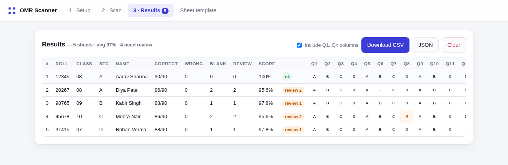
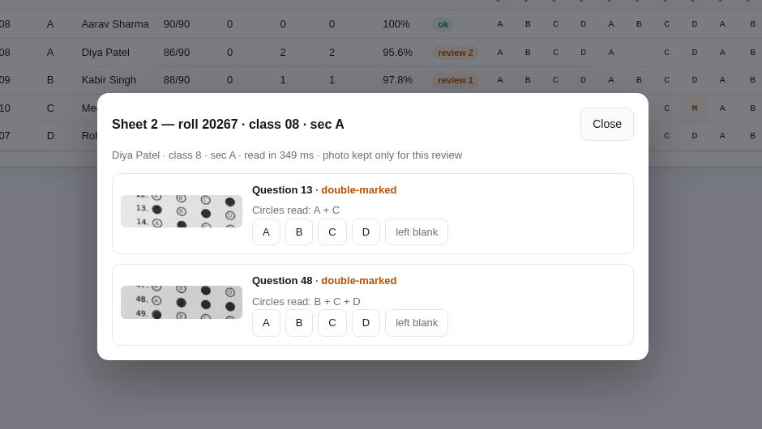
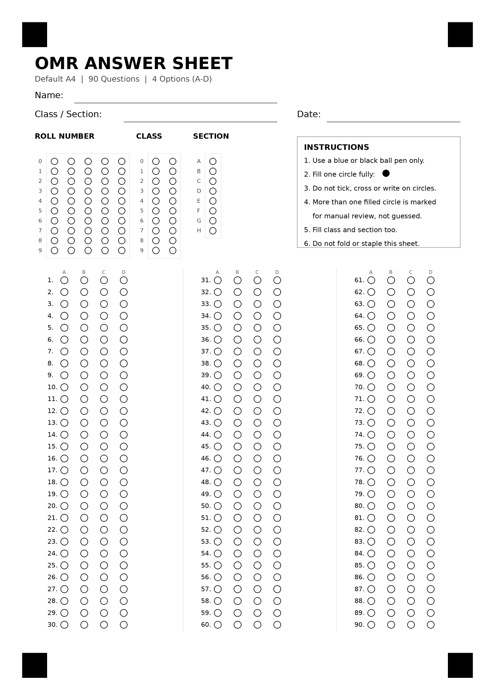

# OMR Scanner

Scan OMR answer sheets with a phone camera and get a spreadsheet. Runs entirely in the browser — no server, no accounts, no per-scan cost, no image storage.

<p align="center">
  
</p>

Fill an answer key once, photograph each sheet, and you get one row per student: roll number, name, class, every question's marked option, and the score. Anything a human should look at is flagged instead of guessed.

---

## What it does

- **Reads bubbles, not text.** No OCR and no cloud API — it is geometry and pixel darkness, so it works offline and costs nothing per sheet.
- **Roll, class and section from bubbles.** Three small bubble grids are 100 % reliable, unlike handwriting — and they matter, because a roll number usually repeats across sections. The name is then looked up from a roster CSV you upload.
- **Answer key, once.** Type `ABCDABCD…` in one line, tap a grid, or load a JSON file. Several sets (A/B/C/D) can be kept as separate templates.
- **Double marks are flagged, never guessed.** If two circles are both filled, that question goes into a review list with a zoomed crop of the actual bubbles, and you pick the answer in one tap.
- **Photos are thrown away.** A sheet with nothing to review is discarded the moment it is read. Only the row of results is kept.
- **Exports CSV and JSON**, with or without the `Q1…Qn` columns.
- **Installable PWA** — add to home screen, works with no network.

<p align="center">
  
</p>

---

## Quick start

### Use it from GitHub Pages (recommended)

> **पहली बार GitHub इस्तेमाल कर रहे हैं?** यहाँ हिंदी में पूरी स्टेप-बाय-स्टेप गाइड है:
> [`docs/publish-guide-hindi.pdf`](docs/publish-guide-hindi.pdf) · [Markdown version](docs/PUBLISH-GUIDE-HINDI.md)


1. Fork or clone this repo.
2. **Settings → Pages → Source: Deploy from a branch → `main` / `root`.**
3. Open `https://<your-user>.github.io/<repo>/` on the phone.

### Install it on the phone

Once the page opens, the app installs like any other:

- **Android / Chrome** — tap the **Install app** button inside the app (Setup tab), or the ⋮ menu → *Install app*.
- **iPhone / Safari** — Share icon → *Add to Home Screen*. (iOS never shows an install button; this is the only route.)

You get an icon on the home screen that opens full screen with no address bar, and keeps working with no internet.

Camera access needs HTTPS, which GitHub Pages gives you. Opening `index.html` from disk (`file://`) will not allow the camera or the sample photos — use the file picker instead, or run a local server.

### Run it locally

```bash
python3 -m http.server 8000
# then open http://localhost:8000
```

### Print the answer sheet

Download [`samples/omr-sheet-blank.pdf`](samples/omr-sheet-blank.pdf) and print it **at 100 % / "actual size"**, not "fit to page". The four black corner squares are what the scanner locks onto.

<p align="center">
  
</p>

---

## The flow

1. **Setup** — enter the answer key, optionally upload `roster.csv` (`roll,name,class,section`).
2. **Scan** — start the camera, frame the sheet so all four corner squares are visible, capture. Or pick several photos at once. A sheet takes ~100–400 ms.
3. **Results** — check the table. Rows with a badge open a review dialog: zoomed crops of every double-marked question, with one-tap overrides. The score updates immediately.
4. **Export** — CSV opens straight in Excel, Google Sheets or LibreOffice.

---

## How it works

```
photo ──► grayscale ──► find 4 corner squares ──► homography
                                                      │
                          template bubble centres ────┤
                                                      ▼
                              sample a small disc inside each bubble
                                                      │
                            darkest bubble = answer, two similar = flag
```

The template lives in a fixed **1000 × 1414 canonical space** that maps onto A4. Only bubble centres are ever projected into the photo, so the app never builds a full-size warped image — that is what keeps it fast and keeps memory flat regardless of camera megapixels.

Two details that make it behave in real classrooms:

- **Row shadows are cancelled.** Each question is compared against its own palest bubble, so a shadow across the page does not invent marks.
- **Three or more inked circles is always a flag.** A student who fills A, B and C is not "A with noise"; the question is handed to you.

### Storage

| What | Size |
|---|---|
| Result row for one student (90 questions, CSV) | **~220 bytes** |
| 1 000 students, full CSV | **~220 KB** |
| Whole app (HTML + JS + CSS) | **~70 KB** |
| Photo of a sheet, if it were saved | 300 KB – 3 MB |

Nothing is written to disk except what you export. Photos live in memory only while a sheet is being read, and are dropped immediately unless a question is flagged — in which case the photo is kept just long enough for you to review it and is released when the dialog closes. **1 000 students cost well under a megabyte.**

---

## Nothing is hardcoded — use your own sheet

The bundled A4 sheet is a **default**, not a requirement. The engine reads whatever the template describes: any question count, any number of options, any number of columns, and any set of bubble fields (roll / class / section, or none at all).

So a 30-question sheet works exactly like the 90-question one — same speed, same accuracy, same CSV export. The answer key simply has 30 entries instead of 90.

`tools/test_variants.js` proves this on four differently shaped sheets that ship with the repo:

| Sheet | Questions | Options | Columns | Bubble fields |
|---|---|---|---|---|
| `q30-1col` | 30 | 4 | 1 | roll + class + section |
| `q30-2col` | 30 | 4 | 2 | roll + class + section |
| `q20-5opt` | 20 | **5** | 1 | roll only |
| `q51-3col` | 51 | 4 | 3 | roll + class + section |

All four read correctly, including the deliberate double mark and the deliberately blank question on each.

There is exactly **one** non-negotiable thing about your sheet: it needs **four solid black squares, one near each corner**. That is what the scanner locks onto to undo the camera angle. Everything else is your choice.

### Your own answer sheet

Two ways:

- **Generate it.** `tools/generate_sheet.py` renders the default sheet and writes `templates/default-a4-90q.json`. Change `DEFAULT_TEMPLATE` to alter the question count, options, columns, or roll digits, then re-run:

  ```bash
  python3 tools/generate_sheet.py     # needs pillow and numpy
  ```

- **Use your existing sheet.** It must have four solid black squares, one near each corner. Go to **Sheet template → Upload a photo of your blank sheet**, click the four squares in order, then tune the pitch and radius fields until the blue overlay dots sit on your circles. The roll, class and section grids are described by `fields` in the template JSON — set `digits` to `0` for any field your sheet does not have. Save it and the template is stored in the browser and exported as JSON you can commit.

---

## Tests

```bash
python3 tools/generate_sheet.py    # builds sample photos + fixtures
node tools/test_engine.js          # 5 sheets, incl. rotation, low res, faint pencil

python3 tools/make_variants.py     # 30 / 20 / 51-question sheets, 5 options, no fields
node tools/test_variants.js        # checks the engine honours each template's shape

node tools/test_ui.js              # headless browser: scan → table → review → CSV
```

`test_engine.js` needs the `.raw` fixtures from the first command; `test_ui.js` needs Chromium and `puppeteer-core` available to Node.

The engine reads all five synthetic sheets exactly: correct roll, class and section, every double mark flagged, every blank counted, on sheets that are rotated, low-resolution, and filled with light pencil. The four variant sheets — different question counts, five options, no class/section field — pass too.

---

## Why not just OCR the handwritten name?

Because it would not work well enough to trust, and it would cost money.

Handwriting recognition is a different problem from bubble reading. Tesseract — the free offline option — is built for printed text and typically lands around 40–70 % character accuracy on cursive handwriting, worse on mixed English/Devanagari names. Cloud OCR (Google Vision, Azure) does better, roughly 70–90 % on neat handwriting, but it means:

- sending every student's name and marks to a third party,
- an internet connection for every scan,
- a bill — around $1–1.50 per 1 000 pages — plus a key to manage.

A name read 80 % right is worse than no name at all, because it looks plausible. So the app reads what bubbles do perfectly and looks the rest up:

| Field | How |
|---|---|
| Roll number | bubbles (5 digits) |
| Class | bubbles (2 digits) |
| Section | bubbles (A–H) |
| Name | roster CSV lookup on roll + class + section |
| Answers, score | bubbles |

If two students share a roll number in different sections, the class and section bubbles disambiguate them — that case is tested.

---

## Honest limitations

- **Handwriting is not read.** Names come from the roster, matched on the bubble-read roll + class + section. See above for why.
- **It needs the four corner markers.** A sheet without them cannot be aligned. If auto-detection fails, retake the photo with the whole sheet in frame and even lighting.
- **Very skewed or very low-resolution photos will fail.** The app tells you so rather than returning wrong answers. Keep the sheet flat, fill the frame, avoid shadows across the bubbles.
- **Thresholds are judgement calls.** The two sliders in Setup (ink sensitivity, double-mark strictness) exist because pens, pencils, printers and phone cameras all differ. Calibrate once on your own sheets, then leave them.
- **Always spot-check.** Treat the output as a fast first pass, not a final result — that is what the review list is for.

---

## Repo layout

```
index.html               app shell
app.js                   UI logic, camera, review, CSV
omr-engine.js            detection engine (no dependencies, also runs in Node)
styles.css
sw.js, manifest…         PWA / offline
templates/               sheet templates as JSON (fields = roll/class/section grids)
samples/                 printable sheet, demo photos, answer key, roster
tools/generate_sheet.py  sheet renderer + synthetic photo generator
tools/make_variants.py   builds sheets of other shapes (30 q, 5 options, ...)
tools/test_engine.js     engine test
tools/test_variants.js   proves any question count / layout works
tools/test_ui.js         headless UI test
docs/                    screenshots
```

---

## शुरुआत (Hinglish)

1. Repo ko GitHub par push karo → Settings → Pages → `main` / `root` → jo link mile use phone par kholo.
2. **Sheet template** tab se PDF download karke A4 par 100 % size par print karo.
3. **Setup** tab me answer key ek line me type karo (`ABCDABCD…`) aur roster CSV upload karo (`roll,name,class,section`).
4. **Scan** tab: camera on karo, chaaron kaale corner square frame me rakho, capture dabao.
5. **Results** me jo row par "review" ka badge hai use kholo — jis question me do circle bhare hain, uska crop dikhega, wahin se sahi option chun lo.
6. **Download CSV** dabao. Bas.

Naam haath se likha hua OCR se nahi padha jaata — wo roll, class aur section ke bubbles se roster me match hota hai. Isi liye sheet par teeno grids bharna zaroori hai.

Photo kahin save nahi hoti — sirf result row rehti hai, isliye 1000 students ka pura data 1 MB se kam me aa jaata hai.

---

## License

MIT — see [LICENSE](LICENSE). Use it in your school, change it, ship it.
